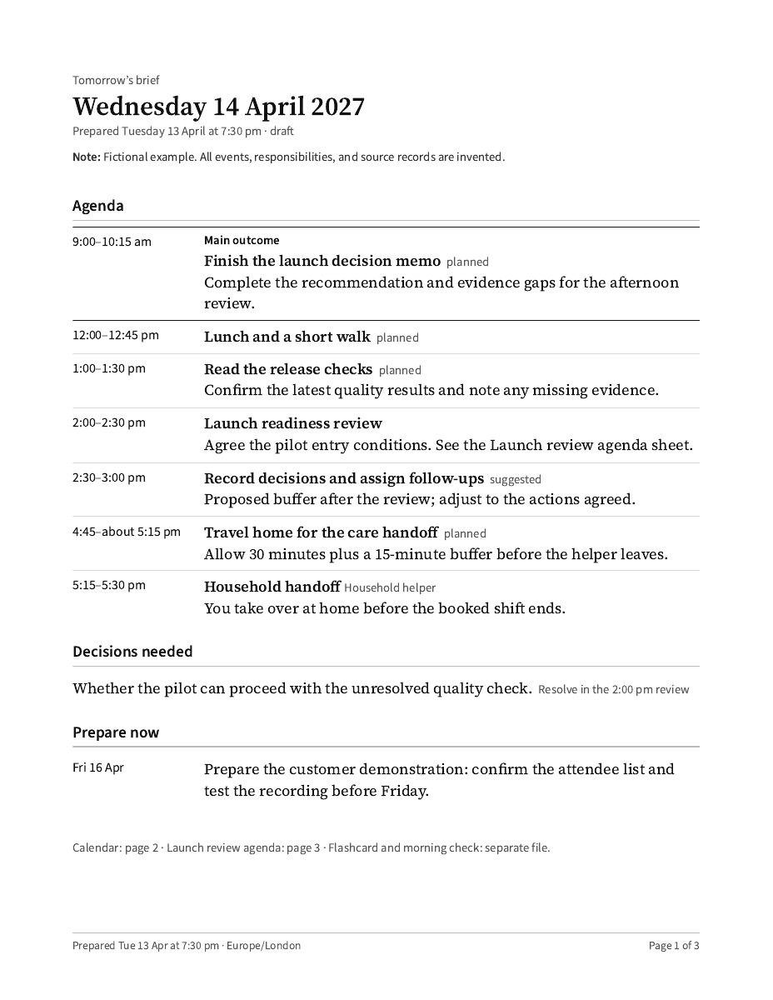

# Daily Brief

An evening planning interview that produces a printable brief for the next day: a chronological agenda, a calendar view, decisions, preparation due now, and meeting agendas.

The download includes two skills:

- **daily-brief-setup** interviews the user and builds a private reference for work patterns, household responsibilities, protected time, goals, travel, food, and tools.
- **daily-brief** uses that reference, a daily rundown, and available connected sources to build a feasible plan.



[Print example](examples/sample-brief.pdf) · [Phone example](examples/sample-brief-phone.pdf) · [Flashcard](examples/sample-brief-flashcard.pdf)

All example people, events, dates, responsibilities, and source records are fictional.

## Install and start

1. Download the repository ZIP and unzip it, or clone the repository.
2. Ask your coding assistant: **“Read this repository's README. Install both included skills into your user skills directory, then run daily-brief-setup.”**
3. The assistant identifies its supported skills directory and can use the installer below. Installation refuses to overwrite existing skills.
4. Start `daily-brief-setup` and answer its questions. After setup, ask **“Use daily-brief to plan my next day.”** A first invocation of daily-brief also routes to setup when no profile exists.

```sh
python scripts/install.py --skills-dir /path/to/your/runtime/skills
```

Replace the path with the actual skills directory for your assistant. Use `python3` when that is the Python command on your machine. Both folders must remain siblings. Downloading or installing files cannot start an AI conversation by itself; the first skill invocation starts the interview.

These are portable Markdown skills with Python helpers. They require an assistant that can read skill files, converse with the user, and access local files. Connector access depends on the host. Voice and scheduling depend on host features and are optional. No particular model is required.

## What setup covers

Setup offers a quick baseline or a fuller interview. It saves progress, skips irrelevant areas, and returns to deferred topics later.

The reference covers work and commute patterns, rotating schedules, priorities, protected time, dependents, school and activity calendars, shared-care arrangements, handoffs, household help, meals, travel, and exercise. It does not assume that every user has a partner or children.

The tool interview asks about Outlook, Gmail, calendars, Todoist, Apple Reminders, Jira, GitHub, Asana, Confluence, Slack, Teams, and other systems the user relies on. It records account aliases, workspace scopes, source-of-truth roles, verified access, and manual fallbacks. Naming an app does not connect it.

The assistant retrieves relevant permitted information before asking for it. Unavailable employer accounts work through a manual meeting and task rundown. Credentials are never collected in the interview.

## The nightly brief

The interview reconciles fixed commitments, in-progress work, blocked tasks, requests from colleagues, side projects, and personal responsibilities. It asks one or two lookahead questions about preparation for the next few days and following week.

When planning Sunday on Saturday, the skill checks what Monday requires and reserves Sunday time for preparation that cannot wait until the evening check-in. That can include supplies, work materials, care arrangements, or instructions for household help. The same lead-time check applies before other workweek start days.

When the proposed day is too full, it recommends what to keep, defer, shorten, delegate, or renegotiate. It does not promise that another person will respond. Meeting sheets use available invitations, conversations, tickets, documents, and prior actions to prepare decisions and questions.

The print design uses a white page, Source Serif 4 body text, Source Sans 3 headings and labels, thin rules, and a separate calendar page. It begins with the agenda and has no opening summary. A phone edition and separate outcome flashcard use the same facts.

## Private storage

The public package contains code, empty templates, and fictional examples. Each user chooses a separate private data folder during setup. Local folders and locally synced Google Drive, OneDrive, or Dropbox folders are supported.

The configuration pointer defaults to `~/.daily-brief/config.json`; `DAILY_BRIEF_CONFIG` can select another private pointer. The state helper rejects data folders inside this package or the installed skills directory. Reference updates and historical records use backups, stale-write checks, and atomic replacement. One computer is the writer for a synced folder.

Do not commit a completed reference, tool inventory, daily report, transcript, account export, or credential file. The package's release audit is a useful check, not a guarantee that arbitrary personal information is detectable. Cloud upload completion is separate from a successful local save.

[Privacy and release notes](docs/PRIVACY.md) explain the boundaries.

## Rendering

HTML output needs Python 3.10 or newer. The renderer embeds the bundled fonts and makes no application-account or remote-font requests.

```sh
python skills/daily-brief/scripts/render_briefing.py examples/sample-day.json --out-dir /private/output --html-only
```

Verified PDF output also requires a Chrome-family browser and Poppler's `pdfinfo`, `pdffonts`, `pdftotext`, and `pdftoppm` commands on PATH. The browser is discovered on common macOS, Windows, and Linux paths; `--browser /path/to/browser` overrides discovery. Python installations without IANA timezone data may need the `tzdata` package.

```sh
python skills/daily-brief/scripts/render_briefing.py examples/sample-day.json --out-dir /private/output
```

Open the main HTML normally for print, or append `#phone` for the phone layout. Without PDF dependencies, HTML is available for manual printing, but PDF layout is not marked verified. The checked example was rendered on macOS with Chrome and Poppler. Other platforms still require a local installation test.

The renderer uses [Chrome's documented headless printing](https://developer.chrome.com/docs/automation-and-testing/headless). Fonts are bundled under their [SIL Open Font Licenses](skills/daily-brief/assets/fonts/SourceSerif4-OFL.txt), with their original source URLs and hashes retained in the font folder.

## Development and sharing

```sh
python -m unittest discover -s tests
python scripts/audit_release.py
python scripts/package.py --out /path/outside/repository/daily-brief-skills.zip
```

The ZIP contains only the files in `release-files.json`. The audit checks those files, PDF text and metadata, unexpected files, credentials, local home paths, and an optional private denylist. Poppler is required to inspect PDF text during a release audit. Run the audit after any example change and inspect the rendered pages before publishing.

Create a GitHub repository, then upload the clean package or push this repository. Your chosen GitHub account will identify the publisher. Keep personal state outside that repository.

Code and original documentation are MIT licensed. Bundled fonts retain their separate licenses. See [LICENSE](LICENSE) and [THIRD_PARTY_NOTICES.md](THIRD_PARTY_NOTICES.md).

### Interview history and daily preparation

The private database keeps questions, answers, decisions, and task history. Each twentieth planning interview reviews that history for useful changes to the questions and brief. Resuming an interview or revising a report does not advance the counter. Older structured records retain their original wording and are labeled as historical records.

Each daily interview checks meals and preparation for existing supplements. Confirmed routines reduce repeat questions. Weekly menu design remains optional. The skill uses the model selected in your host app; it does not change that setting.
